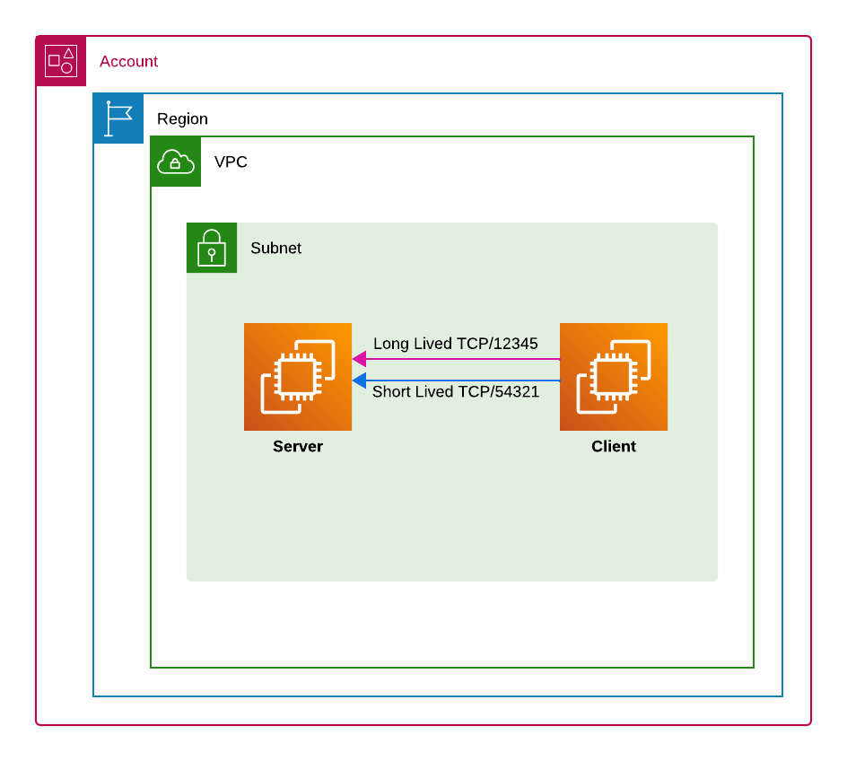

# TCP Tests

[](https://github.com/greyinghair/tcptests/actions/workflows/python-lint.yaml)

Current version: **0.0.3** (see [VERSION](./VERSION)). Requires Python 3.10 or newer.

Long Lived Connections (LLC) & Short Lived connections (SLC)



All test will be from Client-1 to Server-1, Client-2 to Server-2 etc

Each server listens on 2 x ports.  1 port for Short Lived Connections and the 3nd port for Long lived Connections:

| Connection Type | Server port | Keepalive | New Conn Every |
| --------------- | ----------- | --------- | -------------- |
| Long Lived | 12345 | Every 10 seconds	| n/a |
| Short Lived	| 54321	| n/a | Every 1 sec |


## Prerequisites

IAM role (same role as used for SSM) permissions: [PutMetricData,  CreateLogGroup, CreateLogStream, PutLogEvents, DescribeLogStreams]

role inline attached policy: [inline_policy](./iam/iam_inline_role.yml) </br>
role attached AWS managed policy: "AmazonSSMManagedInstanceCore" </br>
Trust Relationships: [trust_relationship](./iam/iam_trust_relationship.yml)


## Logging


* Client Local Logging : Info level logging is sent to /var/log/tcp_client.log
* Cloudwatch Logging


# Server Setup

Create tcp_server.py in /opt/scripts containing code:
```
sudo mkdir /opt/scripts && sudo nano /opt/scripts/tcp_server.py
```

[tcp_server.py](./tcp_server.py)

Setup service to run on boot:
```sudo nano /etc/systemd/system/tcpserver.service```

```
[Unit]
Description=TCP Server
 
[Service]
ExecStart=/usr/bin/python3 /opt/scripts/tcp_server.py
WorkingDirectory=/opt/scripts/
Restart=always
User=root
 
[Install]
WantedBy=multi-user.target
```

Start service & enable at boot: ```sudo systemctl start tcpserver.service && sudo systemctl enable tcpserver.service```

Verify service status: ```sudo systemctl status tcpserver.service```
Verify service is listening on both ports: ```netstat -ltn```
Check Logs for service: ```sudo journalctl -u tcpserver```


# Client Setup

Copy `requirements.txt` alongside the scripts in `/opt/scripts`, then install the
pinned client dependencies in a virtual environment:

```sh
python3 -m venv /opt/scripts/.venv
/opt/scripts/.venv/bin/python -m pip install -r /opt/scripts/requirements.txt
```

Set `aws_region` and `server_ip` in `tcp_client.py` for your environment and
configure an AWS region for CloudWatch Logs (for example, `AWS_DEFAULT_REGION`).

Create tcp_client.py in /opt/scripts containing code: ```sudo mkdir /opt/scripts && sudo nano /opt/scripts/tcp_client.py```

[tcp_client.py](./tcp_client.py)

Setup client tests to run as a service: ```sudo nano /etc/systemd/system/tcpclient.service```

```
[Unit]
Description=TCP Client
 
[Service]
ExecStart=/opt/scripts/.venv/bin/python /opt/scripts/tcp_client.py
WorkingDirectory=/opt/scripts/
Restart=always
User=root
 
[Install]
WantedBy=multi-user.target
```

Start service & configure to run at boot: ```sudo systemctl start tcpclient.service && sudo systemctl enable tcpclient.service```

## Development and updates

```sh
python3 -m venv .venv
.venv/bin/python -m pip install -r requirements-dev.txt
.venv/bin/ruff check .
.venv/bin/ruff format --check .
.venv/bin/python -m unittest discover -s tests -v
.venv/bin/pip-audit -r requirements.txt
```

CI checks Python 3.10 and 3.14, including socket echo tests and a stubbed AWS
metric test. It audits the runtime dependencies weekly and on each pull request.
Dependabot checks Python dependencies and GitHub Actions weekly.

To publish a release, update `VERSION` and the version above in a pull request.
After the change reaches `main` and Python CI passes, the release workflow
creates the matching tag and GitHub release at the tested commit. Existing
versions are left in place.
